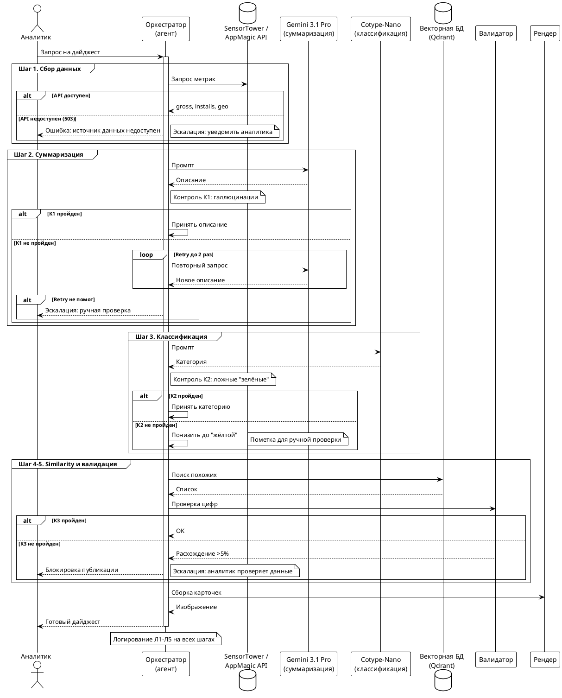
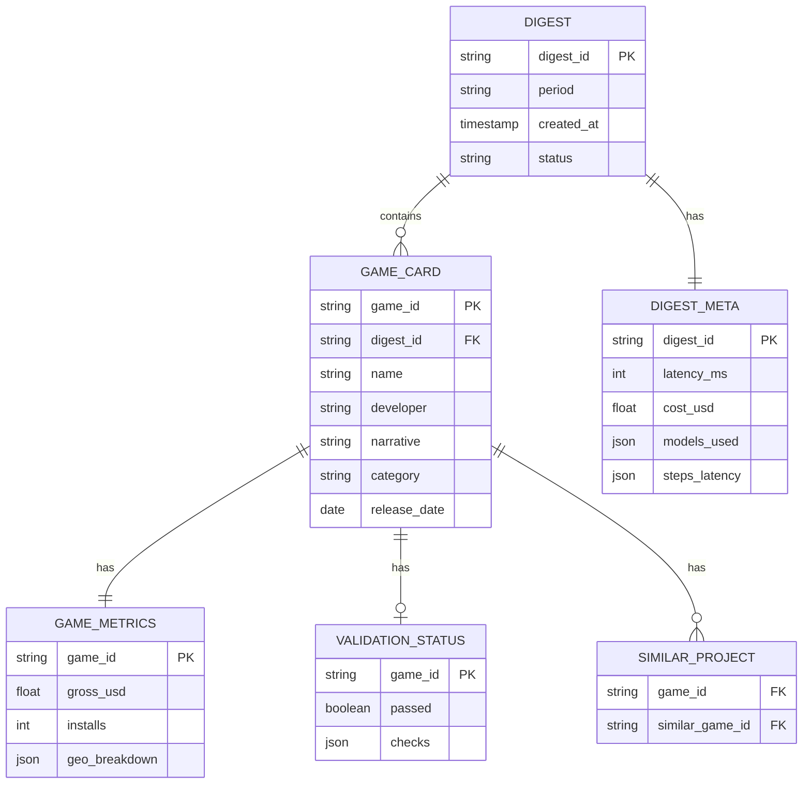

# Дизайн AI-пайплайна

**Роль:** AI Engineer
**Спринт:** Lab2 — Design
**Дата:** 2026-10-15
**Связанные документы:** [research.md](./research.md), [model-candidates.md](./model-candidates.md)

---

## 1. Общая архитектура

Пайплайн — агентная сборка из четырёх последовательных шагов. Прямые промпты не подходят, потому что задача требует оркестрации (сбор → суммаризация → классификация → сборка). RAG не подходит, потому что нет базы знаний — данные приходят из внешнего API.

### Схема пайплайна (PlantUML)

Схему можно отрендерить на [plantuml.com/plantuml](https://www.plantuml.com/plantuml/uml/).

---

## 2. Точки контроля качества

| ID | Где | Что проверяем | При провале |
|---|---|---|---|
| К1 | После суммаризации | Галлюцинации, путаница с похожими играми | Retry до 2 раз, затем эскалация аналитику |
| К2 | После классификации | Ложные «зелёные» на случайных всплесках | Понизить категорию, пометить для ручной проверки |
| К3 | Перед публикацией | Соответствие gross/installs первоисточнику | Блокировка публикации, эскалация при расхождении >5% |
| К4 | Финал | Соответствие структуры карточки шаблону | Отклонить, пересобрать |

---

## 3. Точки логирования

| ID | Когда | Что пишем |
|---|---|---|
| Л1 | Начало пайплайна | request_id, timestamp, список игр, источник данных |
| Л2 | Финал пайплайна | request_id, latency по шагам, стоимость, статус |
| Л3 | Каждый вызов модели | модель, input/output tokens, стоимость, latency |
| Л4 | Провал контроля качества | ID контроля (К1–К4), причина, input/output |
| Л5 | Retry | номер попытки, причина, результат |

Формат — JSON-строки, по одной на событие.

---

## 4. Границы контекста

### Что модель видит

**Суммаризация:** название, разработчик, дата релиза, платформы, описание из стора, промо-материалы, жанр, метрики gross/installs.

**Классификация:** метрики за 4 недели, geo-разбивка, категория из предыдущего дайджеста, описание нарратива из шага 2.

### Что модель НЕ видит

- Внутренние данные студии (метрики своих продуктов, юнит-экономика).
- Персональные данные (имена аналитиков, комментарии из чатов).
- Чужие дайджесты и внутренние документы конкурентов.
- Сырые логи и метаданные API (токены, URL с параметрами).
- Исторические дайджесты за прошлые периоды.

---

## 5. Что дальше

- **ADR выбора моделей** — [model-candidates.md, раздел «Решение»](./model-candidates.md).
- **Спайки** — [spikes/lab2.md](./spikes/lab2.md).
- **Контракт API** — [api/openapi.yaml](./api/openapi.yaml).

---

## 6. ERD: хранилище дайджестов

Схема описывает, где хранятся данные для `GET /digest/{digest_id}`.

Таблицы соответствуют схемам из `api/openapi.yaml`.
